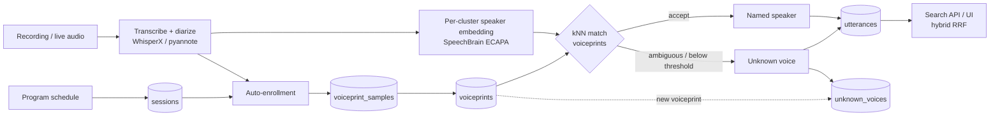

# Speaker Identification on Elasticsearch: Spec

**Status:** Draft · **Last updated:** 2026-11-09

---

## 1. Summary

Automatically work out who is speaking at a conference, without anyone labeling voices by hand, and make every talk and Q&A searchable by *who said what*.

Elasticsearch is the core data layer for both halves of the feature:

| Concern | Elasticsearch capability |
|---|---|
| "Whose voice is this?" | `dense_vector` + approximate kNN over voiceprints |
| "Find the right talk / moment" | `text` + `semantic_text` fields, hybrid search with the RRF retriever |
| Fixing labels after the fact | `_update_by_query` |
| Privacy and erasure | `_delete_by_query`, per-conference scoping |

---

## 2. Goals and non-goals

### Goals
- Identify enrolled speakers in recorded sessions (talks, panels, Q&A) with timestamps.
- Enroll scheduled speakers automatically from the conference program. No manual labeling.
- Search transcripts by topic, by speaker, or both, and return jump-to timestamps.
- Give voices that aren't enrolled stable labels ("Unknown speaker 3"), and relabel them later if that person enrolls.
- Keep voiceprints opt-in, scoped to one conference, and deletable.

### Non-goals (v1)
- Naming anyone who hasn't opted in.
- A global voice registry shared across conferences.
- Perfect attribution of overlapping speech.
- Face or video-based identification.

---

## 3. Architecture



### Components

| Stage | Library | Notes |
|---|---|---|
| Audio extraction | `ffmpeg` | Convert to 16 kHz mono WAV |
| Transcription + diarization (batch) | **WhisperX** (faster-whisper + pyannote `community-1`) | Word-level timestamps plus local speaker labels |
| Diarization (alternative) | **pyannote.audio 4.x**, `speaker-diarization-community-1` | Needs a Hugging Face token and accepting the model terms |
| Live diarization (stretch) | **diart** | Repo looks inactive; fallback is running pyannote on rolling chunks |
| Speaker embeddings | **SpeechBrain** `speechbrain/spkrec-ecapa-voxceleb` | 192-dim ECAPA-TDNN; Apache-2.0 |
| Storage + search | **Elasticsearch** (recent 9.x or Serverless) | Needs `dense_vector` kNN, `semantic_text`, RRF retriever |
| Evaluation | **pyannote.metrics** | Diarization error rate (DER) plus identification error |
| Service layer | FastAPI (suggested) | Thin API over the pipelines and ES |

> **Rule:** enrollment and identification must use the **same embedding model**. Every vector is stored with a `model_id`, and every kNN query filters on it.

---

## 4. Data model

Five indices. Every document carries `conference_id` so data never leaks between events.

### 4.1 `sessions`: the program schedule

| Field | Type | Notes |
|---|---|---|
| `session_id` | keyword | |
| `conference_id` | keyword | |
| `title` | text | |
| `abstract` | text | |
| `room` | keyword | |
| `start_time`, `end_time` | date | |
| `scheduled_speaker_ids` | keyword (array) | Used for auto-enrollment and to narrow kNN |
| `session_type` | keyword | `talk` / `panel` / `keynote` / `workshop` |
| `recording_uri` | keyword (`index: false`) | |

### 4.2 `voiceprint_samples`: one document per enrollment clip

Kept so centroids can be recomputed and audited. Not searched with kNN.

| Field | Type | Notes |
|---|---|---|
| `sample_id` | keyword | |
| `person_id` | keyword | |
| `conference_id` | keyword | |
| `model_id` | keyword | e.g. `speechbrain/spkrec-ecapa-voxceleb` |
| `source` | keyword | `schedule` / `registration` / `manual` / `retro` |
| `session_id` | keyword | Where the clip came from |
| `duration_s` | float | |
| `audio_uri` | keyword (`index: false`) | Lets you re-embed if the model changes |
| `embedding` | dense_vector, 192 dims, `index: false` | Stored for recompute only |
| `created_at` | date | |

### 4.3 `voiceprints`: one document per (person, conference, model)

This is the index the matcher searches.

```json
PUT voiceprints
{
  "mappings": {
    "properties": {
      "person_id":          { "type": "keyword" },
      "name":               { "type": "text", "fields": { "raw": { "type": "keyword" } } },
      "affiliation":        { "type": "keyword" },
      "conference_id":      { "type": "keyword" },
      "model_id":           { "type": "keyword" },
      "centroid": {
        "type": "dense_vector",
        "dims": 192,
        "index": true,
        "similarity": "dot_product"
      },
      "sample_count":       { "type": "integer" },
      "total_speech_s":     { "type": "float" },
      "consent_granted_at": { "type": "date" },
      "updated_at":         { "type": "date" }
    }
  }
}
```

- Document `_id` = `{conference_id}:{person_id}:{model_id}`, so a re-enrollment overwrites the old document instead of duplicating it.
- `dot_product` needs **unit-length vectors**. L2-normalize every embedding before indexing or querying. This gives cosine similarity at lower cost.
- `centroid` = the normalized mean of that person's normalized sample embeddings (see §5.3).

### 4.4 `utterances`: one document per speaker turn (or turn chunk)

```json
PUT utterances
{
  "mappings": {
    "properties": {
      "utterance_id":   { "type": "keyword" },
      "conference_id":  { "type": "keyword" },
      "session_id":     { "type": "keyword" },
      "session_title":  { "type": "text" },
      "room":           { "type": "keyword" },
      "start_s":        { "type": "float" },
      "end_s":          { "type": "float" },
      "speaker_id":     { "type": "keyword" },
      "speaker_name":   { "type": "keyword" },
      "speaker_status": { "type": "keyword" },
      "match_score":    { "type": "float" },
      "text":           { "type": "text", "copy_to": "text_semantic" },
      "text_semantic":  { "type": "semantic_text" }
    }
  }
}
```

- `speaker_id` holds either a `person_id` or an unknown-voice ID (e.g. `unk_s12_03`).
- `speaker_status` is one of `identified`, `ambiguous` or `unknown`.
- `semantic_text` with no `inference_id` uses the cluster's default inference endpoint (ELSER). For multilingual conferences, point it at a multilingual embedding endpoint instead (see §10).
- **Chunk long turns.** A 25-minute talk is one diarization turn. Split turns into roughly 30–60 s windows on sentence boundaries, so search hits land on a precise timestamp.

### 4.5 `unknown_voices`: unresolved speaker clusters

| Field | Type | Notes |
|---|---|---|
| `unknown_id` | keyword | e.g. `unk_s12_03` |
| `conference_id`, `session_id` | keyword | |
| `model_id` | keyword | |
| `embedding` | dense_vector, 192 dims, `dot_product`, indexed | Searched when new voiceprints arrive |
| `duration_s` | float | |
| `best_candidate_id`, `best_score` | keyword, float | For review UI |
| `resolved_person_id` | keyword | Set when relabeled |

---

## 5. Pipelines

### 5.1 Schedule ingest
Load the program (CSV/JSON from the organizer) into `sessions`. This is the free supervision signal that removes manual labeling.

### 5.2 Session processing (batch)
1. **Extract audio:** `ffmpeg -i talk.mp4 -ac 1 -ar 16000 talk.wav`
2. **Transcribe + diarize** with WhisperX. The output is segments with word timestamps and local labels (`SPEAKER_00`, `SPEAKER_01`, …).
3. **Embed each local cluster:**
   - Gather that cluster's segments.
   - Drop segments shorter than about 1 s, and drop overlapped regions.
   - Concatenate up to about 60 s of clean speech.
   - Embed with ECAPA and L2-normalize.
4. **Identify** each cluster (§5.4).
5. **Bulk-index utterances**, chunked as described in §4.4.
6. **Index unresolved clusters** into `unknown_voices`.

**Two-pass order:** run enrollment (§5.3) over *all* sessions first, then identification. That way a Q&A question in session 1 can match a speaker who was only enrolled from their own talk in session 9.

### 5.3 Auto-enrollment from the schedule
For each session with `session_type = talk` and exactly one scheduled speaker who has consented:

1. Within the scheduled slot, find the **dominant cluster** (the one with the most speech time). The session chair's intro and the audience fall into other clusters.
2. **Guards:** skip and flag for review unless both of these hold:
   - the dominant cluster has at least 60% of the slot's speech;
   - the dominant cluster has at least 60 s of speech in total.
3. **Optional corroboration:** the transcript of the first ~90 s mentions the scheduled speaker's name (the chair's intro).
4. Write a `voiceprint_samples` document (`source: schedule`) and recompute the centroid:

```python
import numpy as np

def recompute_centroid(sample_embeddings: list[np.ndarray]) -> np.ndarray:
    E = np.stack([e / np.linalg.norm(e) for e in sample_embeddings])
    c = E.mean(axis=0)
    return c / np.linalg.norm(c)
```

**Panels and multi-speaker sessions are never auto-enrolled.** Speakers there rely on registration samples or manual confirmation.

### 5.4 Identification

Query `voiceprints` with the cluster embedding, restricted to this conference and model:

```json
POST voiceprints/_search
{
  "knn": {
    "field": "centroid",
    "query_vector": [0.0123, -0.0456, 0.0789],
    "k": 5,
    "num_candidates": 50,
    "filter": [
      { "term": { "conference_id": "confx-2026" } },
      { "term": { "model_id": "speechbrain/spkrec-ecapa-voxceleb" } }
    ]
  },
  "_source": ["person_id", "name", "affiliation"]
}
```
*(`query_vector` truncated here. In practice it is 192 normalized floats.)*

**Score conversion:** for `dot_product` on unit vectors, Elasticsearch reports `_score = (1 + cosine) / 2`, so `cosine = 2 * _score - 1`. Set every threshold in cosine terms.

**Decision rule:**

```python
def decide(hits, cluster_speech_s, T_ACCEPT=0.55, MARGIN=0.10, MIN_SPEECH_S=3.0):
    if cluster_speech_s < MIN_SPEECH_S or not hits:
        return "unknown", None, None
    cos = [2 * h["_score"] - 1 for h in hits]
    top, second = cos[0], (cos[1] if len(cos) > 1 else -1.0)
    if top >= T_ACCEPT and (top - second) >= MARGIN:
        return "identified", hits[0]["_source"]["person_id"], top
    if top >= T_ACCEPT:
        return "ambiguous", hits[0]["_source"]["person_id"], top
    return "unknown", None, top
```

- `T_ACCEPT`, `MARGIN` and `MIN_SPEECH_S` are **placeholders**. Calibrate them using §7.
- A wrong name is worse than "Unknown speaker." Tune toward a low false-accept rate.
- **Narrowing the candidate pool:** for a talk, you can add a filter or boost for that session's `scheduled_speaker_ids` and known attendees. A smaller pool means fewer false matches.

### 5.5 Retroactive relabeling
Whenever a voiceprint is created or updated:

1. Run kNN on `unknown_voices` using the new `centroid`, filtered to the same `conference_id` and `model_id`, and only where `resolved_person_id` doesn't exist yet.
2. For each hit that passes the decision rule, set `resolved_person_id`, then relabel that voice's utterances:

```json
POST utterances/_update_by_query
{
  "query": { "term": { "speaker_id": "unk_s12_03" } },
  "script": {
    "source": "ctx._source.speaker_id = params.pid; ctx._source.speaker_name = params.name; ctx._source.speaker_status = 'identified';",
    "params": { "pid": "p_0042", "name": "Jane Doe" }
  }
}
```

### 5.6 Human corrections
- The UI lets a user flag "wrong speaker" and reassign it.
- Confirmed reassignments can optionally be added as `voiceprint_samples` with `source: manual`. This improves the voiceprint over the course of the event, especially for Q&A-mic audio.

### 5.7 Live mode (stretch)
1. Run diart, or pyannote on rolling 5–10 s windows, from the room feed.
2. Keep a running mean embedding for each local speaker.
3. Once a speaker has at least 3 s of speech, query `voiceprints` every few seconds and show "Now speaking: …".
4. When a turn ends, write it to `utterances`.

The ES kNN query is cheap; computing the embedding dominates latency.

---

## 6. Search API

| Endpoint | Purpose |
|---|---|
| `GET /search?q=&speaker=&session=` | Hybrid topic search, optionally filtered by speaker or session |
| `GET /speakers/{person_id}/utterances` | Everything a person said, by time |
| `POST /sessions/{id}/process` | Run §5.2 on a recording |
| `POST /enroll` | Registration clip + consent → §5.3 steps 4+ |
| `POST /utterances/{id}/correct` | §5.6 |
| `DELETE /people/{person_id}` | Erasure (§8) |

### 6.1 Hybrid search ("what did Jane say about RAG evaluation?")

```json
GET utterances/_search
{
  "retriever": {
    "rrf": {
      "retrievers": [
        {
          "standard": {
            "query": {
              "bool": {
                "must": { "match": { "text": "RAG evaluation" } },
                "filter": [
                  { "term": { "conference_id": "confx-2026" } },
                  { "term": { "speaker_id": "p_0042" } }
                ]
              }
            }
          }
        },
        {
          "standard": {
            "query": {
              "bool": {
                "must": { "semantic": { "field": "text_semantic", "query": "RAG evaluation" } },
                "filter": [
                  { "term": { "conference_id": "confx-2026" } },
                  { "term": { "speaker_id": "p_0042" } }
                ]
              }
            }
          }
        }
      ]
    }
  },
  "_source": ["session_id", "session_title", "speaker_name", "start_s", "end_s", "text"]
}
```

Drop the `speaker_id` filter to search across everyone. The response gives `session_id` and `start_s`, which the UI turns into a deep link like `recording_uri#t=start_s`.

### 6.2 "Who talked most about X?"

```json
GET utterances/_search
{
  "size": 0,
  "query": {
    "bool": {
      "must": { "semantic": { "field": "text_semantic", "query": "agent benchmarks" } },
      "filter": [
        { "term": { "conference_id": "confx-2026" } },
        { "term": { "speaker_status": "identified" } }
      ]
    }
  },
  "aggs": { "by_speaker": { "terms": { "field": "speaker_name", "size": 10 } } }
}
```

---

## 7. Calibration and evaluation

1. **Labeled set:** annotate 3–5 sessions in RTTM format (true names, who spoke when). Include at least one panel and one Q&A-heavy session.
2. **Metrics:**
   - DER (diarization quality) with `pyannote.metrics`.
   - At the cluster level:
     - **identification accuracy**;
     - **false-accept rate** (labeled as the wrong person);
     - **false-reject rate** (an enrolled person labeled unknown).
3. **Threshold sweep:** grid over `T_ACCEPT` and `MARGIN`. Pick the operating point with near-zero false accepts and acceptable recall.
4. **Channel-mismatch check:** enroll from talk audio (podium mic), then test on the same people's Q&A or panel audio (room or handheld mic). Expect lower scores; this is where `ambiguous` earns its keep.
5. **Pool-size check:** re-run with 50, 500 and 5,000 voiceprints (padding with VoxCeleb identities) to see how false accepts grow with gallery size.

---

## 8. Privacy, consent and retention

Voiceprints are biometric data. GDPR treats them as special-category data, and Illinois' BIPA requires written consent. This is not legal advice; confirm requirements with the organizer.

- **Opt-in only.** Speakers consent via the speaker agreement; attendees via a registration checkbox. Auto-enrollment (§5.3) runs only for speakers with consent recorded.
- **Per-conference scope.** Everything is keyed by `conference_id`. There is no cross-event registry in v1.
- **Retention.** Delete `voiceprints`, `voiceprint_samples` and `unknown_voices` a fixed number of days after the event. Keep transcripts, with names only for people who consented.
- **Erasure (`DELETE /people/{id}`):**
  1. `_delete_by_query` on `voiceprints` and `voiceprint_samples` for that `person_id`.
  2. `_update_by_query` on `utterances` to reset them to an unknown label.
- **Unknown voices** never get a name unless that person enrolls. Their embeddings exist only to allow relabeling within the retention window.
- **Access.** Use scoped ES API keys per service. Never return vectors to clients. Recent Elasticsearch versions exclude `dense_vector` values from `_source` by default; keep it that way.

---

## 9. Milestones

| # | Deliverable | Done when |
|---|---|---|
| M1 | Batch transcript | One recording → WhisperX → JSON with local speaker labels |
| M2 | ES identification | Indices created; schedule-based enrollment; kNN labels clusters in `utterances` |
| M3 | Search | Hybrid search endpoint + minimal UI with jump-to-timestamp |
| M4 | Feedback loop | Retroactive relabeling + manual corrections |
| M5 (stretch) | Live | Mic feed → "Now speaking: …" in near real time |

---

## 10. Risks and open questions

- **Short Q&A turns** give noisy embeddings. Mitigations: pool a cluster's speech across the whole session, the `MIN_SPEECH_S` guard, and the `ambiguous` status.
- **Overlapping speech in panels.** Diarization still struggles here; exclude overlapped regions from embeddings.
- **Channel mismatch** between the podium mic and audience mics. Mitigations: manual-correction samples (§5.6), and enrolling from more than one source.
- **Gated models.** pyannote and WhisperX diarization need a Hugging Face token and accepted model terms. Set these up before the event.
- **diart maintenance.** Treat live mode as a stretch goal, with chunked pyannote as the fallback.
- **Model changes.** Swapping the embedding model invalidates every vector. `audio_uri` on samples makes re-embedding possible; `model_id` filters prevent mixing models.
- **Open:** which inference endpoint should `semantic_text` use? ELSER is English-focused; a multilingual embedding model may be needed if talks aren't in English.
- **Open:** should known attendees be a hard filter or a soft boost in §5.4? Decide after the pool-size check in §7.
